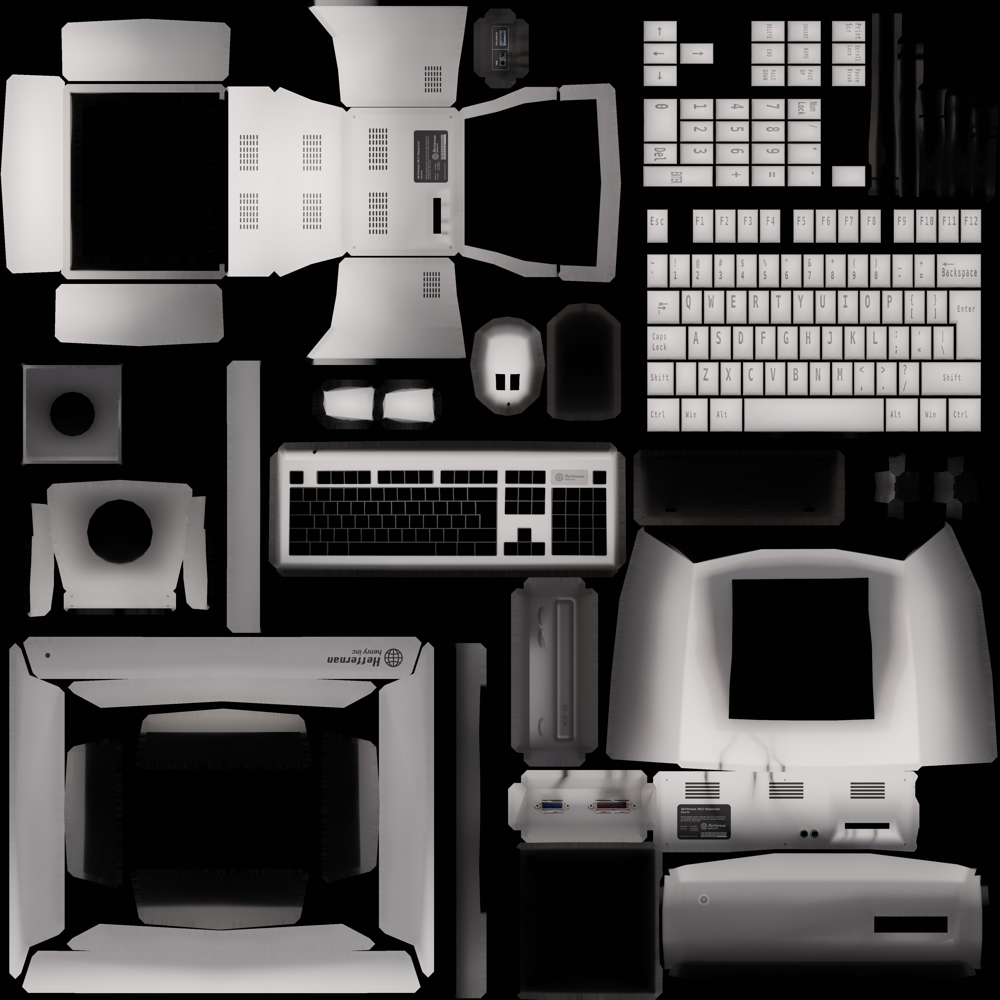

# 💻 Sumit Singh — 3D Retro Computer Portfolio

An interactive, vintage 1990s desktop and 3D workstation portfolio built with **React**, **Three.js**, **@react-three/fiber**, and **Tailwind CSS**. Inspired by classic retro computing aesthetics and modern WebGL interactive experiences.



---

## 🌟 Highlights & Features

- **🎮 3D Retro Workstation**:
  - Fully textured 3D room environment with vintage beige PC tower, mechanical keyboard, classic mouse, document trays, and coffee mug.
  - Realistic camera animations transitioning between Room Overview and Zoomed-in CRT Monitor Focus.
  - Ambient office acoustics, mechanical keyboard clicks, and floppy disk drive sound effects.

- **🖥️ Authentic Retro Windows 95/98 OS**:
  - **About Me**: Professional summary, software engineering internships (**Ducktale IT Services**, **iApp Technologies LLP**), academic qualifications (M.C.A., B.C.A.), and honors.
  - **Featured Projects**: Complete deep-dives into flagship systems:
    - **Chekers VIP**: Enterprise Mobile & Cloud Payment Engine (Flutter, GCP Cloud Functions, Stripe Live 3DS2 SCA, Play Integrity API).
    - **Thought Form**: AI-Powered Query Classification & Multi-Source Intelligence Platform (114 categories, NLI models, Gemini API).
    - **The Curator**: Full-stack MERN blogging & social platform with Google OAuth, RBAC, and AI content assistant.
  - **Skills & Hardware Diagnostics**: 6-category technical diagnostics with real-time proficiency meters.
  - **Resume Viewer**: Full 3-page CV transcript with printable view.
  - **Classic Entertainment & Tools**: Retro Notepad, Winamp-style Media Player with audio visualizer, and Minesweeper 95.

---

## 🛠️ Tech Stack

- **Frontend & 3D**: React 18, TypeScript, Three.js, @react-three/fiber, @react-three/drei, Tailwind CSS.
- **State Management**: Zustand.
- **Styling & Retro Assets**: Custom Windows 95 UI styling, pixel fonts, custom SVG icons, and CRT scanline effects.
- **Build Tooling**: Vite.

---

## 🚀 Getting Started

### Prerequisites
- Node.js (v18 or higher recommended)
- npm or yarn

### Installation

```bash
# Clone the repository
git clone https://github.com/sumit2jan/3d-retro-portfolio.git
cd 3d-retro-portfolio

# Install dependencies
npm install

# Start local development server
npm run dev
```

Visit `http://localhost:3000` in your browser.

### Production Build

```bash
npm run build
```

---

## 👤 Author

**Sumit Singh**  
- **Email**: [rajputsumit2815@gmail.com](mailto:rajputsumit2815@gmail.com)  
- **Location**: Chandigarh, India  
- **GitHub**: [@sumit2jan](https://github.com/sumit2jan)  

---

## 📜 License
MIT License.
